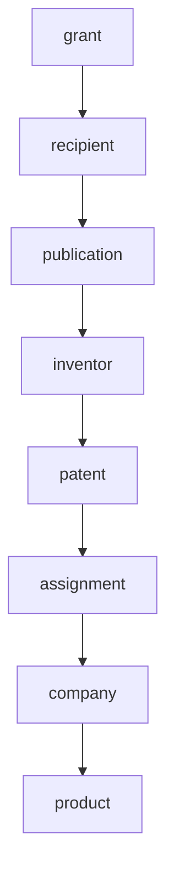

# Public innovation provenance — {{seed_label}}

Generated {{generated_at}}. Direction {{direction}}. Confidence vocabulary is established / corroborated / inferred / unresolved / not-applicable.

## Seed

- Type:
- Canonical id:
- Aliases:
- Question:

## Chain (short)

Government funding → research → knowledge / invention → IP → ownership → license → commercial entity → product → capital / revenue / acquisition / procurement

Fill only hops that were searched. Leave missing hops visible.

Replace this stub with node ids from provenance.json.

## Nodes

| id | type | label | primary identifier |
|---|---|---|---|

## Edges

| from | type | to | confidence | source | identifier | as_of |
|---|---|---|---|---|---|---|

## Public-return ledger

| Dimension | Finding | Confidence | Source |
|---|---|---|---|
| Public funding | | | |
| Research output | | | |
| IP | | | |
| Ownership | | | |
| Government license | | | |
| Licensing | | | |
| Commercialization | | | |
| Capitalization | | | |
| Acquisition | | | |
| Government use | | | |
| Public access | | | |
| Revenue | | | |
| Royalty | | | |
| Follow-on public funding | | | |

## Gaps

| Hop | What was searched | What would close it |
|---|---|---|

## Negative searches

One line per miss. See references/sources.md.

## What this pack does not claim

- Completeness of any agency or patent corpus
- That commercialization equals public return
- Any dollar ratio
